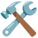

<!-- Hero -->
<div align="center">
  <picture>
    <source media="(prefers-color-scheme: dark)" srcset="./dark.svg">
    <source media="(prefers-color-scheme: light)" srcset="./light.svg">
    
  </picture>
</div>

<br>

<div align="center">
  <picture>
    <source media="(prefers-color-scheme: dark)" srcset="./images/intro-dark.gif">
    <source media="(prefers-color-scheme: light)" srcset="./images/intro-light.gif">
    
  </picture>
</div>

<p align="center">
  <a href="https://abhinaba-chanda.github.io/"></a>
  <br>
  <b> <a href="https://abhinaba-chanda.github.io/">abhinaba-chanda.github.io</a> </b>
</p>

---

##  𝐇𝐞𝐥𝐥𝐨 𝐭𝐡𝐞𝐫𝐞, 𝐟𝐞𝐥𝐥𝐨𝐰 <𝚌𝚘𝚍𝚎𝚛 />! 


 **I build things, put them on the internet, and learn a ton doing it.**

I'm Abhinaba, a developer from India who's into web development, Python and AI. I'm sharpening my JavaScript and Python right now, and I've already spent time with C, C++ and Node.js along the way.

Every project on this profile started as a "can I actually build this?" moment, from an AI study helper to a weather app to a site for my favourite football club. Online I go by **Abhinaba-Dev**, and Windows 11 is where all of it gets built. 

<br clear="right">


###  My Coding Journey


-  **Already know:** C, C++ and Node.js
-  **Learning right now:** JavaScript and Python
-  **Most excited about:** web development, Python and AI
-  **My setup:** Windows 11, Cursor, GitHub Copilot and Claude AI
-  **How I work:** pick an idea, build it, break it, fix it, ship it

<br clear="right">

> [!NOTE]
> I'm still learning, and I'm proud of it. Each project here taught me something new, and the next one will teach me more. 

> [!IMPORTANT]
> **Right now I'm focused on:** getting really good at JavaScript and Python, and mixing web development with AI to build smarter projects. 

> [!TIP]
> When I'm not coding, I'm watching football  (Messi and FC Barcelona all the way ), listening to music  or gaming .

> [!WARNING]
> Bring up Messi and you might lose the next hour of your day.  Also, maybe I'm funny. 

<picture>
  <source media="(prefers-color-scheme: dark)" srcset="./assets/languages.svg?v=1">
  <source media="(prefers-color-scheme: light)" srcset="./assets/languages-light.svg?v=1">
  
</picture>

> [!IMPORTANT]
> -  **My live projects:**
> -  **[AI Study Buddy](https://abhinaba-chanda.github.io/ai-study-buddy/)**
> -  **[Weather Now](https://abhinaba-chanda.github.io/weather-now/)**
> -  **[Barça & Beyond](https://abhinaba-chanda.github.io/fc-barcelona-fan-page/)**
> -  **[Smart File Organizer (Windows app)](https://github.com/abhinaba-chanda/smart-file-organizer/releases/tag/V1)**

> [!TIP]
> -  Want to collaborate or have a question? Reach me at **[abhinabachanda491@gmail.com](mailto:abhinabachanda491@gmail.com)**

<p align="center">
  <a href="mailto:abhinabachanda491@gmail.com"></a>
  <a href="https://github.com/abhinaba-chanda"></a>
  <a href="https://abhinaba-chanda.github.io/"></a>
  <a href="https://abhinaba-chanda.github.io/ai-study-buddy/"></a>
  <a href="https://abhinaba-chanda.github.io/weather-now/"></a>
  <a href="https://abhinaba-chanda.github.io/fc-barcelona-fan-page/"></a>
  <a href="https://github.com/abhinaba-chanda/smart-file-organizer/releases/tag/V1"></a>
</p>

---


###  Focus

<p>
  
  
  
  
</p>

<h3 align="left"> Connect with me:</h3>
<p align="left">
<a href="https://github.com/abhinaba-chanda" target="blank"></a>
<a href="mailto:abhinabachanda491@gmail.com" target="blank"></a>
<a href="https://www.instagram.com/abhinba_chanda" target="blank"></a>
<a href="https://www.facebook.com/share/19bsT6NMR1/" target="blank"></a>
<a href="https://www.youtube.com/@ABHINABACHANDA-18" target="blank"></a>
<a href="https://t.me/abhinaba_chanda" target="blank"></a>
<a href="https://discordapp.com/users/1298320498329129046" target="blank"></a>
</p>

<br>

<h3 align="left"> Languages and Tools:</h3>

- Languages
<p align="left">
  <a href="https://skillicons.dev">
    
  </a>
</p>

- Tools
<p align="left">
  <a href="https://skillicons.dev">
    
    
    
    
  </a>
</p>

---

<h3 align="center"> Projects</h3>

<p align="center">
  <a href="https://github.com/abhinaba-chanda/weather-now"></a>
  <a href="https://github.com/abhinaba-chanda/ai-study-buddy"></a>
  <a href="https://github.com/abhinaba-chanda/smart-file-organizer"></a>
</p>

<p align="center"><b>More Projects</b></p>

<p align="center">
   <a href="https://github.com/abhinaba-chanda/python-practice"><b>python-practice</b></a><br>
   <a href="https://github.com/abhinaba-chanda/javascript-practice"><b>javascript-practice</b></a><br>
   <a href="https://github.com/abhinaba-chanda/c-cpp-practice"><b>c-cpp-practice</b></a><br>
   <a href="https://github.com/abhinaba-chanda/python-ai-projects"><b>python-ai-projects</b></a><br>
   <a href="https://github.com/abhinaba-chanda/nodejs-practice"><b>nodejs-practice</b></a>
</p>

---

<h3 align="center"> GitHub Stats</h3>

<p align="center">
  <a href="https://github.com/abhinaba-chanda"></a>
</p>

<details open align="center">
  <summary> More Stats</summary>
  <br>
  <div align="center">
    <a href="https://github.com/abhinaba-chanda"></a>
    <br><br>
    <a href="https://github.com/abhinaba-chanda"></a>
    <a href="https://github.com/abhinaba-chanda"></a>
  </div>
</details>

---

<h3 align="center"> GitHub Contributions</h3>

<p align="center">
  <picture>
    <source media="(prefers-color-scheme: dark)" srcset="./profile-3d-contrib/profile-night-rainbow.svg">
    <source media="(prefers-color-scheme: light)" srcset="./profile-3d-contrib/profile-gitblock.svg">
    
  </picture>
</p>

<p align="center">
  <picture>
    <source media="(prefers-color-scheme: dark)" srcset="https://raw.githubusercontent.com/abhinaba-chanda/abhinaba-chanda/output/github-snake-dark.svg">
    <source media="(prefers-color-scheme: light)" srcset="https://raw.githubusercontent.com/abhinaba-chanda/abhinaba-chanda/output/github-snake.svg">
    
  </picture>
</p>

<p align="center">
  <picture>
    <source media="(prefers-color-scheme: dark)" srcset="https://raw.githubusercontent.com/abhinaba-chanda/abhinaba-chanda/pacman/pacman-contribution-graph-dark.svg">
    <source media="(prefers-color-scheme: light)" srcset="https://raw.githubusercontent.com/abhinaba-chanda/abhinaba-chanda/pacman/pacman-contribution-graph.svg">
    
  </picture>
</p>


<h2 align="center"> 【H o b b i e s】</h2>

<br clear="both">


<p align="center">
   &nbsp;  Football &nbsp;·&nbsp;  Music &nbsp;·&nbsp;  Gaming &nbsp;·&nbsp;  Coding &nbsp;·&nbsp;  Exploring AI &nbsp; 
</p>

<br clear="both">

<p align="center">
  
</p>

<p align="center">
  
  
  
  
</p>

<p align="center">
  <a href="https://abhinaba-chanda.github.io/fc-barcelona-fan-page/"></a>
  <br>
  <b> <a href="https://abhinaba-chanda.github.io/fc-barcelona-fan-page/">Visca Barça! Check out Barça &amp; Beyond, my FC Barcelona &amp; Messi fan site </a></b>
</p>


<details open align="center">
  <summary> More</summary>
  <br>
  <div align="center">
    
    <br><br>
    
    <br><br>
    <p> 𝚈𝚘𝚞 𝚑𝚊𝚟𝚎 𝚜𝚝𝚊𝚢𝚎𝚍 𝚘𝚗 𝚖𝚢 𝚙𝚛𝚘𝚏𝚒𝚕𝚎 𝚏𝚘𝚛 ◔_◔ </p>
    
    <br><br>
    
  </div>
</details>


<div align="center">

```diff
+@ @ @ @ @ @ @ @ @ @ @ @ @ @ @ @ @ @ @ @ @ @ @ @ @ @ @ @+
@@       o o                                           @@
@@       | |                                           @@
@@      _L_L_                                          @@
@@   ❮\/__-__\/❯  A habit missed once is a mistake,    @@
@@   ❮(|~o.o~|)❯    A habit missed twice is a start    @@
@@   ❮/ \`-'/ \❯          of new habit!                @@
@@     _/`U'\_                                         @@
@@    ( .   . )     .----------------------------.     @@
@@   / /     \ \    | while( ! (succed=try() ) ) |     @@
@@   \ |  ,  | /    '----------------------------'     @@
@@    \|=====|/                                        @@
@@     |_.^._|                                         @@
@@     | |"| |                                         @@
@@     ( ) ( )   Testing leads to failure              @@
@@     |_| |_|   and failure leads to understanding    @@
@@ _.-' _j L_ '-._                                     @@
@@(___.'     '.___)                                    @@
+@ @ @ @ @ @ @ @ @ @ @ @ @ @ @ @ @ @ @ @ @ @ @ @ @ @ @ @+
```

</div>


<p align="center">
  
</p>

<p align="center">
  
</p>
